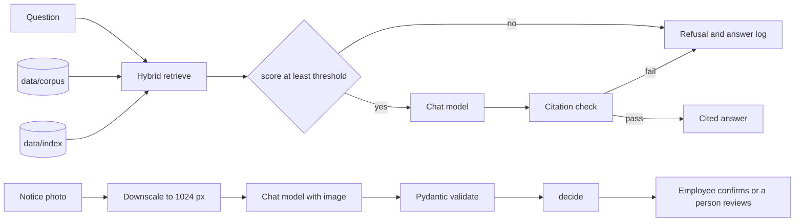

# Design Review · AI Mentor · Lomi

Members: Davit Jincharadze · zidhartha · Repo keeper and Spec keeper · Irakli Giguashvili · Irakligig · Eval keeper · Elene Kifiani · Elene27 · backup Spec keeper and backup Eval keeper · Sandro Paikidze · SanndroP · backup Repo keeper and backup Spec keeper
Repo: https://github.com/zidhartha/AIPSD-F26-Lomi · Graded commit: tag `design-review`

## 1 · Problem, users, success criteria

**Problem.** A junior developer in their first two weeks at a 30-person company has no onboarding team. The rules are in a handbook, so they ask a senior colleague the same questions. Spec: `docs/spec.md`.

**Users.** That junior developer. They know the question and not which page answers it. Sometimes the rule is on a printed notice in their hand, not in a file they can search.

| # | Success criterion | Measured by | Today |
|---|---|---|---|
| S1 | A handbook question returns a cited answer, or the fixed refusal | `evals/golden.yaml` and `logs/answers.jsonl` | 5/5 live. See section 4 |
| S2 | A question the handbook does not contain does not call a model | `tests/test_answer.py` `test_refuses_without_calling_the_model_when_nothing_is_relevant` | passing |
| S3 | A notice photo with a missing required line is not stored as fact | `tests/test_checks.py` `test_degraded_notice_goes_to_review_with_hard_action` | passing |
| S4 | The first-slice passage lookup stays under 50 ms and cites the file | `tests/test_ask.py` | passing |

## 2 · Architecture and data flow

The refusal arrow does not enter the chat model. `src/answer.py` returns before `complete_json` when the best cosine is under the threshold. The notice path never writes a hard field into a form: `decide()` only names it.

| Model call | Model id | Input | Output | Validated by |
|---|---|---|---|---|
| Embed | `openai/text-embedding-3-small` | chunk text or the question | unit vector | `src/index.py` refuses a different model |
| Answer | `MODEL`, default `google/gemini-3.8-flash` | retrieved chunks plus the question | `{answer, citations, grounded}` | `Reply` in `src/answer.py`, then `check_citations()` |
| Notice | same chat model | JPEG, longest side 1024 | value, evidence, confidence per field | `Extraction` in `src/extract.py`, then `decide()` |

`src/ask.py` is still the no-model passage lookup from Lab 2. It reads only the three files in the corpus root.

## 3 · Risks and safety threats

| Risk | What a user would see | Mitigation | Owner |
|---|---|---|---|
| A rule that is not in the handbook, stated as company policy | A confident sentence with a fake citation | Refuse under the threshold with no model call. `check_citations()` refuses an unknown `[n]`, a missing `[n]`, or an uncited sentence. `src/answer.py` | Irakli Giguashvili, Eval keeper |
| A smudged notice stored as fact | The action filled in with a guess | Hard flags stay empty. `docs/confidence-policy.md`, `src/checks.py` | Davit Jincharadze, Spec keeper |
| A photo of a person, an ID, or a lunch menu | A record created from the wrong image | Menus and similar titles are `rejected`. The spec refuses faces and ID documents. `docs/multimodal-spec.md` | Davit Jincharadze, Spec keeper |
| OpenRouter is down, or the key is missing | No grounded answer | `src/ask.py` still returns the passage with no key. Live answers wait. Logged in `logs/usage.jsonl` when a call does happen | Davit Jincharadze, Repo keeper |
| A handbook answer costs more than the team expects | A surprise bill | Photos are downscaled before the call. Chat replies are capped at 1024 tokens. Every call appends tokens, cost, and latency | Irakli Giguashvili, Eval keeper |

## 4 · Evaluation plan

- Golden set: `evals/golden.yaml` · last run: 2026-10-20, `evals/results/2026-10-20-1734-live-k5.json` · result: 5/5, pass rate 1.00, threshold 0.70. Chat model `google/gemini-3.8-flash`, embeddings `openai/text-embedding-3-small`, k = 5.
- What failed and why: nothing in that live run. The earlier offline runs were 3/5 at both k = 5 and k = 1 (`evals/results/2026-10-20-1646-offline-k5.json`, `evals/results/2026-10-20-1646-offline-k1.json`). g3 and g4 failed there because the offline extractor refused them after retrieval. The questions were not weakened. `docs/decisions/0002-k-and-threshold.md`. The live cafeteria refusal did call the model; the model returned not-grounded. The no-model refusal is `tests/test_answer.py`.
- By Week 11 the set grows to 10 questions: 3 factual, 2 reasoning, 2 edge, 2 refusal, 1 format. The 0.70 gate blocks a merge that drops a question that used to pass.

## 5 · Token budget

`logs/usage.jsonl` has 13 live lines: 2 notice photos, 6 embedding calls, and 5 grounded-answer calls. Embed lines logged `cost_usd` 0 because OpenRouter returned the model id `text-embedding-3-small`, and the price table is keyed `openai/text-embedding-3-small`. Those 673 tokens at $0.02 per million are under $0.0001.

| Feature | Model | Tokens in / out (median) | Cost per request | Latency (median) | Source |
|---|---|---|---|---|---|
| Embed, live | `text-embedding-3-small` | 9 / 0 over 6 calls | logged $0 | 756 ms | `logs/usage.jsonl` |
| Grounded answer, live | `google/gemini-3.8-flash` | 320 / 208 over 5 calls | $0.001029 | 3744 ms | `logs/usage.jsonl` |
| Notice photo, live | `google/gemini-3.8-flash` | 1813 / 324 over 2 calls | $0.002575 | 7842 ms | `logs/usage.jsonl` |

Monthly at 50 grounded questions a day, using the live median of $0.001029: about $1.54 a month. The Lab 2 napkin was $2.70 because it assumed 1,650 input tokens. The live calls sent about 320. Putting the whole handbook in the prompt instead of five chunks would send every page on every question. Fifteen short pages are already more input than five chunks, and the corpus is meant to grow. Retrieval stays the path for that reason.

## 6 · Team, roles and decisions

- Team contract: `TEAM-CONTRACT.md` · roles: `docs/TEAM-REPO.md` section 1
- Decision records: `docs/decisions/0001-passage-not-model.md` · `docs/decisions/0002-k-and-threshold.md`
- Next: phone photos in place of the synthetic cards in `tests/images/`. Irakli Giguashvili drives that slice. The rota is in `docs/TEAM-REPO.md` section 1.
