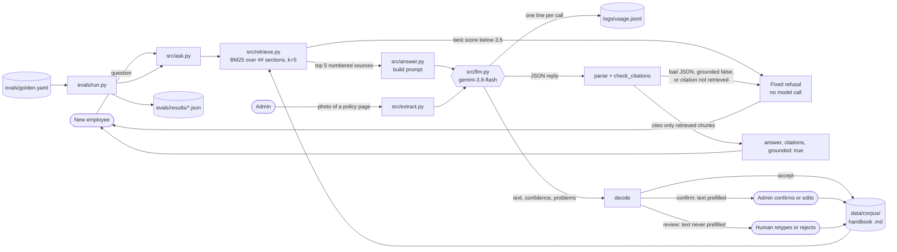

# Design Review · AI Mentor · Team Lomi

**Members:** Davit Jincharadze (zidhartha), Irakli Giguashvili (Irakligig), Elene Kifiani (Elene27), Sandro Paikidze (SanndroP) · **Repo:** [zidhartha/AIPSD-F26-Lomi](https://github.com/zidhartha/AIPSD-F26-Lomi) · **Graded commit:** tag `design-review`

## 1 · Problem, users, success criteria

**Problem.** A junior developer in their first two weeks at a 30-person company has no onboarding team. The rules live in handbooks and policy documents, so they ask the same senior colleague the same basic questions, and sometimes get a half-remembered answer.

**Users.** That new employee, who knows the question ("how do I request time off?") but not which document answers it. HR and the senior colleague are the people who stop being interrupted. Full spec: [docs/spec.md](spec.md) (v0). Seed company: the fictional Brightpath Software, [data/corpus/](../data/corpus/).

| # | Success criterion | Measured by | Today |
|---|---|---|---|
| S1 | A question the handbook answers returns the answer and cites the section it came from | golden g1 to g4 check the cited source and `must_mention` | 3/4 offline ([result](../evals/results/2026-10-20-1613-offline-k5.json)) |
| S2 | A question the handbook does not answer gets the fixed refusal, never an invented policy; a citation that was not retrieved is refused too | golden g5; [tests/test_answer.py](../tests/test_answer.py) (refusal without a model call, six bad-citation cases) | passing |
| S3 | A photo of a policy page reaches the corpus only when the extraction is accepted or a human confirms it | [tests/test_extract.py](../tests/test_extract.py), routes in [docs/confidence-policy.md](confidence-policy.md) | passing |
| S4 | Median cost per question under $0.005 on `google/gemini-3.8-flash` (spec criterion 3) | `python -m evals.usage` over [logs/usage.jsonl](../logs/) | section 5 |

## 2 · Architecture and data flow

| Model call | Model id | Input | Output | Validated by |
|---|---|---|---|---|
| grounded answer | `google/gemini-3.8-flash` (env `MODEL`) | system rules + 5 numbered sources + question | `{answer, citations, grounded}` as JSON | `parse_reply`, then `check_citations` ([src/answer.py](../src/answer.py)) |
| page extraction (Lab 3 feature) | `google/gemini-3.8-flash` | system rules + the photo as a data URL | `{title, text, confidence, problems}` | `validate`, then `decide` ([src/extract.py](../src/extract.py)) |

No embedding model: retrieval is keyword-based ([decision 0001](decisions/0001-keyword-retrieval-over-long-context.md)). Both calls go through [src/llm.py](../src/llm.py), which reads the key from `OPENROUTER_API_KEY` and appends model, tokens, cost and latency to `logs/usage.jsonl`.

**Retrieval to refusal.** The cheapest safety feature: when nothing relevant is found, nothing is generated and nothing is spent ([decision 0002](decisions/0002-refusal-threshold-3-5.md)).
**Model to check.** The model is asked for numbered citations; code maps each number back to a retrieved chunk id. A number outside 1 to k, a missing list, or `grounded: false` becomes the same fixed refusal, never an exception.
**Decide to corpus.** Code, not the model, routes a photo. The two human-in-the-loop points are the admin confirming a prefilled page and a person retyping a page the model could not read.

## 3 · Risks and safety threats

| Risk | What a user would see | Mitigation | Owner |
|---|---|---|---|
| A confident invented policy (a number of leave days, a limit) | a wrong rule, stated as fact | refusal below threshold before any model call; only cited, retrieved chunks are shown ([src/answer.py](../src/answer.py), 14 tests in [tests/test_answer.py](../tests/test_answer.py)); golden g1/g2 check the numbers | Spec keeper (Davit) |
| A real citation attached to a wrong sentence | "60 GEL [expenses#limits]" where the source says 50 GEL | `must_mention` catches known cases; Week 11 adds a judge from a different model family | Eval keeper (Irakli) |
| A useful question refused because the words differ (g3) | "I could not find this…" for a rule that exists | the refusal is safe, not wrong; we watch g3; embeddings as a second ranker if the Week 11 set shows more misses (decision 0001) | Eval keeper (Irakli) |
| A misread photo becomes policy ("24 days" read as "4 days") | a wrong rule for every employee who asks | Lab 3 confidence policy: hard flags and confidence below 0.60 go to review with the text never prefilled ([docs/confidence-policy.md](confidence-policy.md)) | Backup spec keeper (Elene) |
| One company's handbook shown to another company's employee | another firm's rules or salaries | the first slice has one corpus and no tenants; workspace-scoped corpora and a cross-tenant test before any second company, planned for Week 7 | Repo keeper (Davit) |
| Instructions hidden in an uploaded document ("ignore your rules…") | the mentor follows the attacker | sources are passed as numbered data, and the reply must be JSON that code checks; a red-team golden question in Week 12 | Spec keeper (Davit) |
| Personal data in the corpus or logs | a colleague's name, review or salary exposed | the seed corpus is fictional ([data/corpus/README.md](../data/corpus/README.md)); the usage log stores no question text, only tokens, cost and latency | Repo keeper (Davit) |
| Provider outage or price change | an error, or the cost doubles when the promotion ends | the model id is one env variable; a missing key or network failure returns `{error, detail}` ([src/ask.py](../src/ask.py)); cost per call is logged; fallback model planned for Week 10 | Backup repo keeper (Sandro) |

## 4 · Evaluation plan

**Golden set:** [evals/golden.yaml](../evals/golden.yaml), 5 questions: 2 factual, 1 reasoning, 1 edge (typos and no grammar), 1 refusal. Pass threshold 0.70. Each answer question names the section it must cite and the words it must contain.

**Last run:** offline stand-in model, [evals/results/2026-10-20-1613-offline-k5.json](../evals/results/2026-10-20-1613-offline-k5.json): **4/5 (0.80), gate pass.** The stand-in answers with source [1] verbatim, so this run measures retrieval, refusal and citation checks, not wording. The live run (`python -m evals.run`) is committed next to it before the tag, and its pass rate replaces this line.

**What failed and why:** g3, "Can I work from Spain for a whole month?", is refused. BM25 has no notion that Spain is "another country" or that a month is about "20 working days"; the best chunk is Probation (3.11, matching "month"), below the 3.5 threshold. It fails safe: refused, not answered wrongly. Fix candidates, in order: an embedding ranker beside BM25; a synonyms line in the handbook header. Either becomes a decision record.

**By Week 11:** 10 questions by the course rule (3 factual, 2 reasoning, 2 edge, 2 refusal, 1 format), so we add 1 factual, 1 reasoning, 1 edge, 1 refusal (a prompt-injection page) and 1 format (answer in Georgian for a Georgian question). We add a judge from a different model family for what `must_mention` cannot check, and the live run in CI with the key as a repository secret: `evals/run.py` already exits 1 below 0.70, so CI blocks any merge that drops the pass rate below 0.70.

## 5 · Token budget

| Feature | Model | Tokens in / out | Cost per request | Latency | Source |
|---|---|---|---|---|---|
| ask (answered) | gemini-3.8-flash | ~440 / ~70 measured offline | ~$0.0006 at $0.75 / $3.75 per M | from the live run | prompt size from `logs/usage-offline.jsonl`; live median from `python -m evals.usage` |
| ask (refused at retrieval) | none | 0 / 0 | $0 | no model call | g3 and g5 traces: `retrieval_below_threshold` |
| page extraction | gemini-3.8-flash | from the live run | from the live run | from the live run | `logs/usage.jsonl`, feature `extract` |

**Monthly** at one 30-person company asking 50 questions a day (spec): 1,500 questions × ~$0.0006 ≈ **$0.90 a month**, about $1.80 at the standard price when the promotion ends. At 20 such companies: about $18 to $36. The live median replaces $0.0006 before the tag.

**RAG or long context.** Today's seed corpus is ~1,030 tokens, so long context would cost about 3 times our prompt and still be cheap. A real handbook is ~180,000 tokens: 180,000 × $0.75 / M ≈ $0.135 per question, about 200 times our ~$0.0006, and it gives no per-chunk score to refuse on. We retrieve ([decision 0001](decisions/0001-keyword-retrieval-over-long-context.md)).

## 6 · Team, roles and decisions

- **Team contract:** [TEAM-CONTRACT.md](../TEAM-CONTRACT.md), all four members. **Roles:** [docs/TEAM-REPO.md](TEAM-REPO.md) section 1: Davit repo keeper and spec keeper, Irakli eval keeper, Elene backup spec and eval keeper, Sandro backup repo and spec keeper.
- **Decision records:** [0001 · keyword retrieval over long context](decisions/0001-keyword-retrieval-over-long-context.md) · [0002 · refusal threshold 3.5](decisions/0002-refusal-threshold-3-5.md) (the setting we tuned in Lab 4).
- **AI use:** an agent drafted every section; logged in [docs/delegation-log.md](delegation-log.md), entry 1. The team is responsible for every sentence.
- **Next:** Week 5 turns "look up a policy section" into a validated tool (the Tool Contract).
